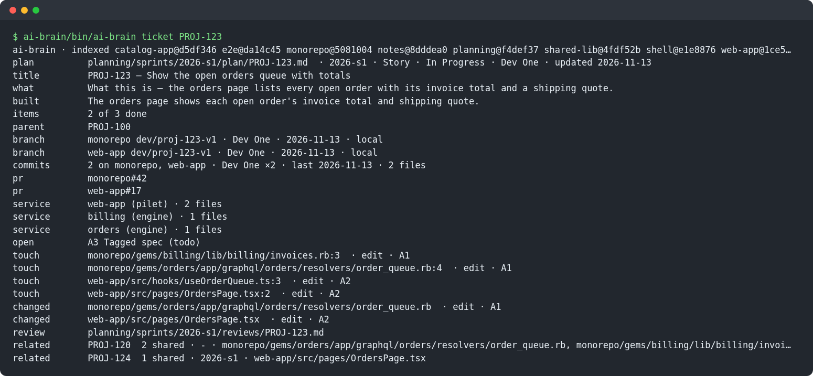
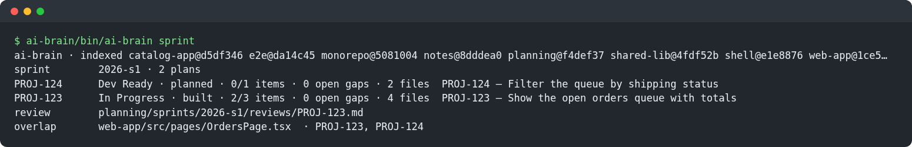
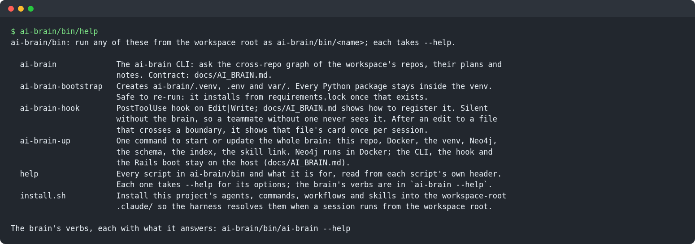
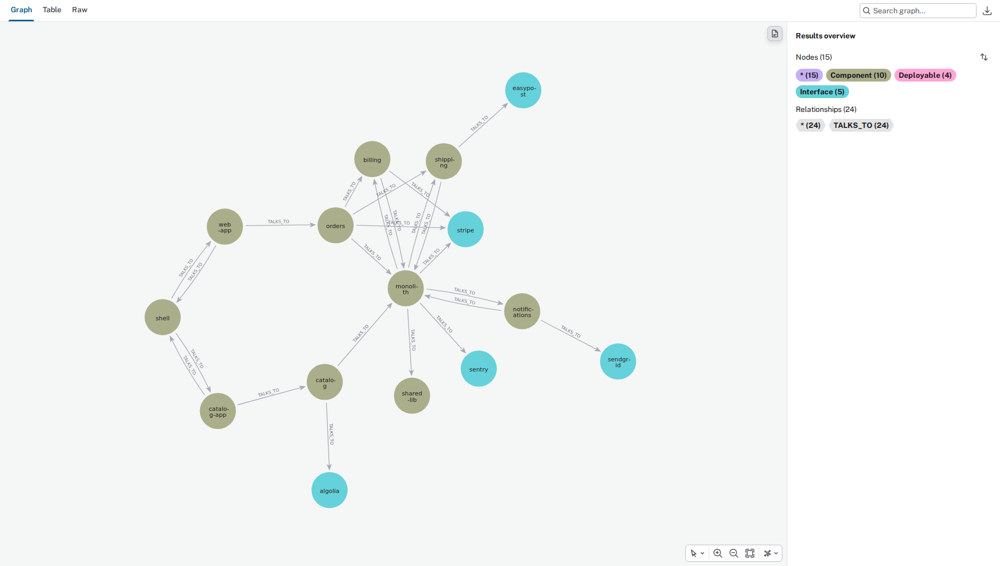
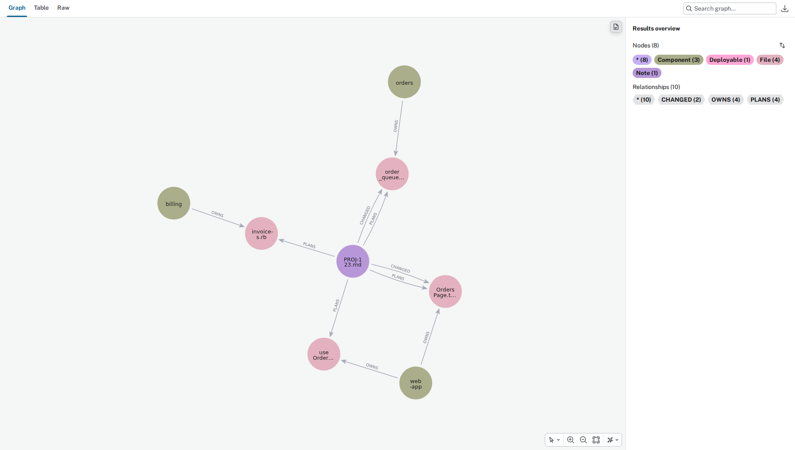
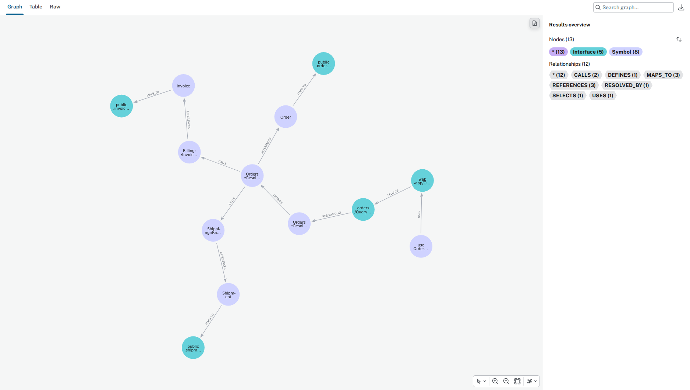
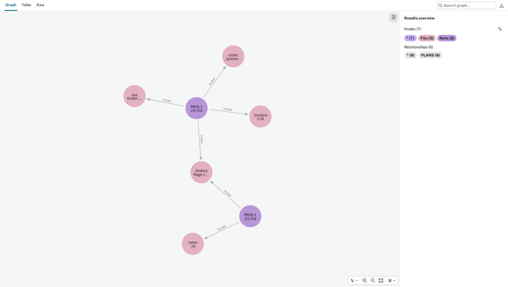

# ai-brain

A cross-repo code graph for coding agents. ai-brain reads every repo in a workspace at `origin/<ref>`, links what
the code states (GraphQL fields and operations, routes, Kafka topics, tables, jobs, frontend pages, tests, plans
and notes) into Neo4j, and answers a question in a few lines of `repo/path:line` instead of a grep across every
repo. It ships a CLI and an edit hook, and a Claude Code harness built on them: five skills, a command and six
agents that plan, build, review, bug-hunt and demo a ticket across the repos ([The harness](#the-harness)).

```
ai-brain/bin/ai-brain surface order queue                      # interfaces by name
ai-brain/bin/ai-brain find format start end                    # code by what it does
ai-brain/bin/ai-brain impact Order.status                      # what a change reaches, with its tests
ai-brain/bin/ai-brain trace Order.status                       # UI to operation to resolver to model to table
ai-brain/bin/ai-brain impact --diff monorepo web-app           # what your checkouts' changes reach outside them
ai-brain/bin/ai-brain impact --diff monorepo@origin/you/proj-123-v1   # a branch you have not checked out
ai-brain/bin/ai-brain ticket PROJ-123                          # plan, files to touch, open gaps, branches, PRs
ai-brain/bin/ai-brain history web-app/src/pages/Orders/Orders.tsx     # the tickets behind a file
```

Every line it prints is a lead with a `path:line`: open the file before you build on it.

One ticket's plan, files, gaps, branches and PRs, then a sprint at a glance. These shots, and the graphs under
[Seeing the graph](#seeing-the-graph), come from a small demo workspace.





## What it fits

It was built for workspaces shaped like this, and reads each part by its role:

- a Rails monorepo with its apps under `apps/<app>/` and engines under `gems/<engine>/`, serving GraphQL
  (graphql-ruby), REST routes, Kafka consumers and background jobs;
- React and TypeScript frontends: micro-frontends (Piral pilets) and the shell that hosts them, talking GraphQL
  (Apollo);
- shared libraries, and a Playwright end-to-end suite whose tests carry ticket tags like `@PROJ-123`;
- services and libraries in other languages, such as Python, Go, Rust, Elixir, Java or Kotlin: their definitions,
  imports, calls and tests, their GraphQL schema files and OpenAPI specs, and in a monorepo the components under
  `packages/`, `services/`, `libs/`, `crates/` and `cmd/`;
- optionally, a notes repo, and plan documents for the tickets you work on.

It parses Ruby, TypeScript and JavaScript in depth with tree-sitter, and every other language whose grammar ships a
tags query through that query. Facts only a running app knows (routes, the GraphQL schema, models, tables, jobs,
Kafka consumers) come from a command you supply per app; for Rails, `[rails]` boots the app with your script
([docs/AI_BRAIN.md](docs/AI_BRAIN.md), Facts from any stack). It draws an edge only where the code states one, so
a call through `send`, a callback or a prop has none. It does not read an issue tracker, a database's rows or a
running app. What it reads in each language, and how to add one, is in [docs/LANGUAGES.md](docs/LANGUAGES.md).

## Requirements

- Linux; it is developed on Ubuntu under WSL2.
- git, Python 3.12 or newer, and curl.
- Docker Engine with the compose plugin. On Ubuntu or WSL2, `ai-brain/ai-brain/setup/install-docker.sh` installs it.
- For Rails facts: the app's Ruby through [mise](https://mise.jdx.dev) and its database running.
- Claude Code, for the skills, the agents and the hooks. The CLI works without it. The harness needs a few more
  tools: [What the skills need](#what-the-skills-need).

## Quick start

1. Put this checkout next to the repos it should read, in one workspace folder, and run everything from that
   folder:

   ```
   my-workspace/
   ├── ai-brain/      # git clone https://github.com/zneret03/ai-brain.git
   ├── monorepo/
   ├── web-app/
   └── shell/
   ```

2. Make a project for the workspace, and list its repos in the copy's `project.toml`:

   ```
   cp -r ai-brain/ai-brain/projects/_template ai-brain/ai-brain/projects/my-workspace
   ```

3. Start everything: `ai-brain/bin/ai-brain-up`. It checks Docker, creates the venv and `.env`, starts Neo4j,
   applies the schema, fetches, indexes every repo, links the skills, agents and command into
   `my-workspace/.claude/`, and runs `doctor`. It is safe to re-run, and later runs index only what moved.
4. Ask it: `ai-brain/bin/ai-brain surface <words>`, or `/ai-brain` in a Claude Code session started at
   `my-workspace/`.
5. Once per machine, add the SessionStart hook in [docs/AI_BRAIN.md](docs/AI_BRAIN.md) (Keeping it current), so
   every session starts Neo4j when it is down and re-indexes in the background what moved.
6. For the harness, copy `ai-brain/profile.example/` to `ai-brain/profile/` and fill it ([The profile](#the-profile)).

`ai-brain/bin/help` lists every script, and each script and each verb takes `--help`.

## The verbs

| Verb | Answers |
| --- | --- |
| `surface <words>` | interfaces by name: GraphQL fields and operations, routes, topics, tables, flags, pages |
| `find <words>` | code by what it does: symbol and parameter names, in every repo |
| `impact <target>` | what reaches a field, operation, route, topic, table, symbol or file, with its tests |
| `impact --diff <repo>[@<ref>]...` | what the branches' changes reach outside them |
| `consumers <target>` | only the direct consumers of an interface |
| `trace <target>` | UI to operation to resolver to model to table; producer to topic to consumer |
| `notes <file or words>` | the notes and plans that cite a file or match words, each ok, moved or gone |
| `ticket <KEY>` | one ticket: plan, files to touch, services, open gaps, branches, commits, PRs, related |
| `sprint [<slug>\|all]` | a sprint's tickets with their state, then the files two of its plans both touch |
| `gaps [<KEY>\|<slug>]` | open gaps and open action items, for one ticket or one sprint |
| `history <repo/path>` | the tickets that planned, built, committed to or cited a file or directory |
| `who <repo/path>` | who wrote a file or directory, and the tickets behind it |
| `related <KEY>` | tickets that touched the same files, the rarest shared files counting most |
| `status` | graph size, coverage, engines, externals and schema skew |
| `fresh` | starts Neo4j if it is down; re-indexes in the background when a repo moved |
| `index` | rebuilds the graph: fetch, parse, link, and write only what changed (`--full` from empty) |
| `cards`, `schema`, `doctor` | re-render the hook's cards, apply Neo4j's constraints, check the setup |

Every script in `bin/`, with what it is for (`ai-brain/bin/help`):



## The project file

`ai-brain/ai-brain/projects/<name>/project.toml` describes one workspace. The template documents each key inline.

| Key | Means |
| --- | --- |
| `[project] name`, `root` | the project's name, and the workspace root: absolute, `~/…`, or relative to the ai-brain checkout (`".."` is its parent) |
| `[[repos]] name`, `role`, `ref` | a folder under `root`; its role, one of `monorepo`, `app`, `pilet`, `shell`, `library`, `e2e`; the branch read at `origin/<ref>` |
| `[[knowledge]] name`, `kind`, `ref` | a folder under `root` read as `notes`, `sprints` or `plans` (below) |
| `[externals] from` | a `Gemfile.lock`; its GIT sources that are not cloned here become externals, and a `library` repo is read at the tag it pins |
| `[rails] app`, `env` | a Rails app under `root`, booted with `bin/rails runner projects/<name>/extractors/rails_introspect.rb` for the facts, in that `RAILS_ENV`; you supply the script |
| `[[facts]] name`, `app`, `command`, `paths`, `env` | a command that writes an app's routes, GraphQL schema, models, tables, jobs or topics as JSON lines, for any stack; the rows are in [docs/AI_BRAIN.md](docs/AI_BRAIN.md) (Facts from any stack) |
| `[extractors] pilet_routing` | a Python file in the project folder whose `router(ctx, repo)` returns a function from a frontend operation name to the engine that answers it; unset, an operation goes to the one GraphQL schema, or with several, to the one whose root type has its top-level fields |
| `[monorepo] roots` | more folders whose subfolders holding a manifest are components, each with its kind, e.g. `{ pilets = "pilet" }`; `packages/`, `libs/`, `crates/`, `services/` and `cmd/` always are |
| `[skip] dirs` | folders under `root` that are not repos, such as a worktree |
| `[tickets] prefix` | ticket keys look like `PROJ-123`, ticket branches like `you/proj-123-v1`; unset, commits and plan names link to no ticket |
| `[names] strip_prefix` | dropped from repo and engine names in output, e.g. `"acme-"` |
| `[names] apps` | a monorepo's `apps/<dir>` to a component name, e.g. `{ acme = "monolith" }` |
| `[http] own_hosts` | host or env-var words that are your own systems, so HTTP calls to them are not external APIs |
| `[languages] include`, `exclude` | the languages read besides Ruby and TypeScript; unset, every one with a tags query. `queries/<language>/tags.scm` beside the file adds one ([docs/LANGUAGES.md](docs/LANGUAGES.md)) |
| `[[graphql.snapshots]] repo`, `path`, `engine` | a schema snapshot committed in a frontend repo, and the engine whose SDL it must match (`status --skew`) |

Several projects share one Neo4j, kept apart by a `project` property. Every verb takes `--project`, and defaults
to the project whose `root` holds the current directory.

## How it reads

- **Git objects at `origin/<ref>`, never the working tree.** `index` fetches first, so a checkout sitting on a
  ticket branch or holding local edits is read as its base branch. `impact --diff <repo>` is the one question
  about your checkout as it stands, committed, uncommitted and untracked.
- **`--pull` only fast-forwards.** A checkout on its base branch with no uncommitted tracked changes moves to
  `origin/<ref>`; anything else is fetched and left exactly as it is.
- **Only what moved is written.** One index runs at a time; later runs parse what changed and boot Rails again only
  when a path that carries facts changed (routes, GraphQL, models, policies, jobs, Kafka, `db/`, a lockfile).
- **A `sprints` repo's `sprints/` and `profile/` are the exception**: both are meant to be gitignored, each
  person's own, and are read from disk on every index.
- **Facts hold names and paths only**: never a table row, an `.env` value or a credential.

## Knowledge repos

All three kinds are optional.

- **`notes`**: Markdown notes whose YAML frontmatter names the code they describe. `notes <file>` then lists each
  note citing a file, with its source ok, moved or gone:

  ```yaml
  ---
  id: orders
  title: How orders are kept
  sources:
    - repo: your-org/monorepo
      ref: main
      paths:
        - apps/app/app/models/order.rb
  ---
  ```

- **`sprints`**: plan documents, one folder per sprint, read from disk, plus the repo's `docs/` pages at `main`
  and its `profile/*.md` pages from disk.
  `ticket`, `sprint`, `gaps`, `history` and `related` answer from them:

  ```
  sprints/<sprint>/plan/<KEY>.md        a ticket's plan; chore-<slug>.md for work with no ticket
  sprints/<sprint>/reviews/<KEY>.md     review rounds
  sprints/<sprint>/reports/<name>.md    test reports
  sprints/<sprint>/bugs/<name>.md       bugs still open
  ```

  The sections it reads in a plan are listed in [docs/AI_BRAIN.md](docs/AI_BRAIN.md) (The plans it reads).
- **`plans`**: an archive of older plans, read from every branch head, newest first.

## Output, exit codes and trust

One header line names the commit each repo was read at, then at most 30 lines of a name and a `repo/path:line`.
Exit 0 means answered (or `none`), 3 not set up, 4 Neo4j unreachable; on 3 or 4 it prints
`ai-brain: not run (<reason>)`. A brain line is a lead, never a verdict: open its `path:line` before it becomes a
claim in a plan, a review or a pull request. The full contract is [docs/AI_BRAIN.md](docs/AI_BRAIN.md).

## Claude Code

- **The skills and agents.** `ai-brain/bin/install.sh` links every skill, agent, command and workflow in
  `.claude/` into the workspace root's `.claude/` (`--copy`, `--status` and `--uninstall` too), and `ai-brain-up`
  runs it. A session started at the workspace root then asks the brain before it greps.
- **The hooks.** A SessionStart hook keeps it current, and a PostToolUse hook shows Claude a file's card after an
  edit to a file that crosses a boundary. Both are in [docs/AI_BRAIN.md](docs/AI_BRAIN.md).

## The harness

Five skills, one command and six agents, linked into the workspace root's `.claude/` by `ai-brain/bin/install.sh`.
Each asks the brain before it greps, and reads your workspace's facts from `ai-brain/profile/` (below).

| Piece | What it does |
| --- | --- |
| `/plan <KEY>` | reads the ticket, its parent and its siblings; maps the files with the brain and has backend and frontend agents verify the map; asks what it could not settle; cuts the ticket branches and writes `sprints/<sprint>/plan/<KEY>.md`. No code |
| `/dev <KEY>` | builds the plan's action items in order, each with its test; runs the gates; clicks the change through on the local stack as each persona, then hunts the edge cases; records before and after evidence into the ticket's evidence folder; opens paired PRs on a yes, with the images uploaded into each |
| `/branch-review <KEY>` | reviews every branch a ticket has through the brain: what the diff reaches, scoped checks, a Rails lane and a React lane, findings by reason; writes a review round to `sprints/`, posts to GitHub only on a yes |
| `/qa-demo` | for the tickets at the tracker's QA gate, records a replication video on the shared environment with a visible cursor, and posts it as one comment per ticket |
| `/ai-brain` | the brain's verbs, for any cross-repo question |
| `/bug-hunt` | the command: serial Playwright hunters over what the diff reaches, the developer fixes what they find, a hunter re-drives every fix; writes its evidence (`evidence/<KEY>/hunt/`) whether or not anything broke |
| agents | `project-manager`, `developer`, `qa-backend`, `qa-frontend`, `qa-design`, `qa-e2e`. `/bug-hunt` runs `developer`, `/branch-review` runs `qa-backend` and `qa-frontend`, the rest run ad hoc |

The flow and its rules (branching, the browser check, what `/dev` never does) are in [CLAUDE.md](CLAUDE.md).

### The profile

The skills hold the workflow; your workspace's facts live in `ai-brain/profile/`, which is gitignored. Copy the
example and fill each page; [profile.example/README.md](profile.example/README.md) says what each one holds:

```
cp -r ai-brain/profile.example ai-brain/profile
```

| Page | Holds |
| --- | --- |
| `REPOS.md` | the repos, base branches, branch and PR rules, gate commands, codegen |
| `MICROSERVICES.md` | the services, what each owns, how they talk |
| `DEFINITIONS.md` | personas, statuses and domain terms |
| `GRAPHQL_SURFACES.md` | where the queries and mutations live |
| `CODE_MAP.md` | per-layer paths, contract files, where shared code lives, conventions |
| `STACK.md` | entry points, the frontend feed, preflight checks, test data |
| `TRACKER.md` | the tracker's site and board, the current sprint, the ticket family, QA gates, how to write to it |
| `E2E.md` | the e2e suite: repo, config, ports, seeding, tags |
| `QA.md` | the shared environment, sign-in, data lookups, recording |
| `LESSONS.md` | what your tickets and reviews taught |

A skill that needs a page you have not filled says which one. The brain reads these pages from disk on every
index, so `notes <file>` finds a profile page that cites a file.

### sprints/

Plans, Dev reports, review rounds, hunt reports and bugs live in `ai-brain/sprints/<sprint>/`, gitignored and each
developer's own. A fresh clone has none: the folder appears when `/plan` writes its first plan
(`ai-brain/bin/plan-doc edit` makes it). The layout is in [docs/SPRINTS.md](docs/SPRINTS.md).

Each ticket's evidence sits beside its plan in `ai-brain/sprints/<sprint>/evidence/<KEY>/`: `/dev`'s screenshots,
GIFs, mp4s and `notes.md`, `/bug-hunt`'s `hunt/` and `/qa-demo`'s `qa/`. It is never committed or pushed. A PR body
names each image as ``, and `ai-brain/bin/pr-images <owner>/<repo>#<number> <evidence folder>`
uploads them through a browser signed in to GitHub and rewrites the body with the links
([docs/SPRINTS.md § Evidence](docs/SPRINTS.md#evidence)).

### What the skills need

- Claude Code, with sessions started at the workspace root.
- The `gh` CLI, signed in, for branches, PRs and review comments.
- A Jira connection through Claude's Atlassian connector, for `/plan`, `/dev`, `/branch-review` and `/qa-demo`.
- Node, and the evidence tooling in `ai-brain/evidence/` (Playwright, pinned): `ai-brain/bin/ai-brain-up` installs
  it when Node is there, or run `npm ci --prefix ai-brain/evidence` and
  `npx --prefix ai-brain/evidence playwright install chromium`. Then, once per machine,
  `ai-brain/bin/pr-images --login` to sign the upload browser in to GitHub; the session stays in
  `ai-brain/evidence/.auth/`, gitignored, and is a credential: never share it.
- Playwright in the workspace's e2e repo (`profile/E2E.md`), for the specs `/bug-hunt` promotes.
- The Figma connector, for `qa-design`.

## Seeing the graph

Neo4j Browser at http://localhost:7474, user `neo4j`, the password in `ai-brain/ai-brain/.env`. Saved views are in
`ai-brain/ai-brain/views/*.cypher`.

| | |
|---|---|
|  **Architecture**: the app, its engines and frontends, and the external APIs they call (`architecture.cypher`) |  **A ticket**: its plan, the files it plans to touch and changed, and the component that owns each (`ticket.cypher`) |
|  **An operation end to end**: `OrderQueue`, from the hook that uses it to the tables it reads (`operation-end-to-end.cypher`) |  **A sprint's overlap**: two plans that both touch `OrdersPage.tsx` (`sprint.cypher`) |

## Troubleshooting

| You see | Do |
| --- | --- |
| `ai-brain: not run (not set up: …)` | `ai-brain/bin/ai-brain-up` |
| `ai-brain: not run (Neo4j unreachable …)` | `ai-brain/bin/ai-brain-up`, or `ai-brain/bin/ai-brain fresh` |
| `The Docker daemon does not answer` | `sudo systemctl start docker`; on `permission denied`, add yourself to the `docker` group (see `install-docker.sh`) |
| `boot failed; keeping the previous facts` | read `ai-brain/ai-brain/var/log/boot.log`; start the app's database, or index with `--no-boot` |
| `facts <name> failed; keeping the previous facts` | read `ai-brain/ai-brain/var/log/facts-<name>.log`, and run the command by hand in its `app` folder |
| the header ends in `stale:` | the named repos moved since the index; `fresh` re-indexes them in the background |
| a background index seems stuck | `ai-brain/ai-brain/var/log/index.log` |
| the wrong project answers | pass `--project <name>`, or run from inside that project's `root` |
| the graph looks wrong after a Neo4j upgrade | stop the container, empty `ai-brain/ai-brain/var/neo4j/data/`, start it, then `ai-brain/bin/ai-brain index --full` |

`ai-brain/bin/ai-brain-up --status` runs `doctor` and changes nothing.

## Working on ai-brain

See [CLAUDE.md](CLAUDE.md): the flow, the venv, the tests, the change discipline and the branching rule.

## License

MIT. See [LICENSE](LICENSE).
